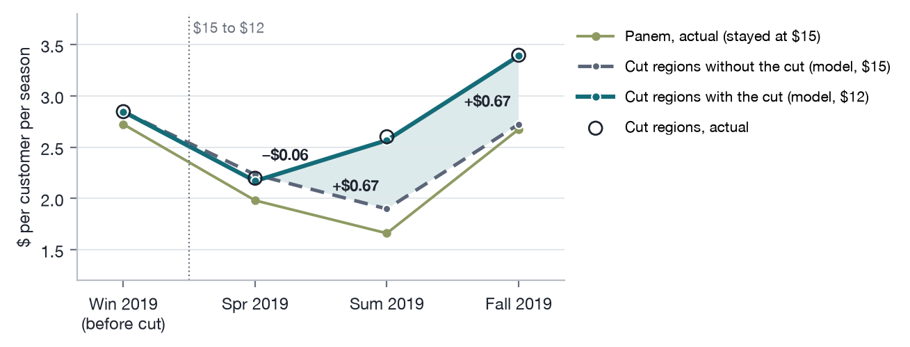
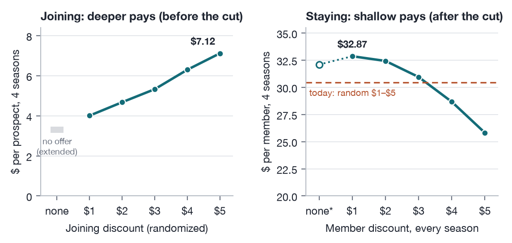

# Lorehaven pricing: what worked and what to change

*Audible Economics & Data Science take-home · write-up*

## The short answers

1. **Did the 2019 cut from \$15 to \$12 work?** Yes. It raised membership in the five cut regions by about 11 percentage points and paid for itself after one season. My models put the gain at \$1.27 per customer over the three seasons after the cut (+19%), about \$456k across the 358k customers in those regions. I would keep the \$12 base.

2. **Do the joining discounts pay, and how deep should they be?** Yes, and deeper is better. Before the cut, a prospect offered \$5 off brought in \$7.12 over four seasons, against \$4.01 at \$1 off and roughly \$3.10 to \$3.50 with no offer. Revenue was still rising at \$5, so the best joining discount may be deeper than anything tested.

3. **What should pricing and discounts look like going forward?** Keep the \$12 base, give offered prospects \$5 off their first season, and replace today's random \$1 to \$5 member discount with a flat \$1. In my forecast tool this brings in 13.7% more revenue per customer over the next four seasons than today's policy, and it stays the best option under 2017, 2018 and 2019 advertising. If keeping members matters more than near-term revenue, \$2 off for members gives up 2.5 points of that gain and ends with about 9,700 more members.

## What the data told me about how to analyze it

- **There is only one control region.** Panem never cut its price or offered discounts, so a difference-in-differences against it rests on one region. Panem also moved on its own: its member share fell from 18.2% to 11.1% in the first half of 2019 with no price change. I ran the DiD, then built a second estimate that does not use Panem.
- **Only the size of a discount is random.** A business rule decides who gets an offer, and the \$1 to \$5 depth is then randomized. Comparisons across depths are causal. "No offer" and full price are one-dollar extrapolations of that curve.
- **Advertising sets the level of joining.** At \$10, 17.3% of offered prospects joined before the cut and 12.1% after, because fewer heard a podcast ad (42% against 32%). With exposure held equal, joining at a given price was the same in both periods. So both models use each customer's own ad exposure instead of season effects, and the price response is then stable across seasons.
- **Members get a new random discount every season,** so cancellation has its own experiment and is modeled the same way.

## Findings

### The price cut

Against Panem, the cut raised membership by 11.5 points (95% CI 8.5 to 14.5). Revenue is less clear. In dollars the DiD gives +\$0.37 per customer per season (CI 0.07 to 0.66), but placebo cuts in 2017 and 2018 show a dollar gap opening anyway, as revenue per customer roughly tripled. In percent it gives +1.5%, with an interval of −16% to +19%.

The second estimate replays the cut regions through 2019 at \$12 and at \$15, using joining and cancellation models fitted only on the randomized discounts (Figure 1). At \$12 it matches actual member share within half a point and revenue within \$0.04 per customer. The cut costs \$0.06 per customer in its first season, while existing members pay \$3 less and new ones build up, then adds \$0.67 in each of the next two. Membership rises 10.4 points, close to the DiD. Panem, which neither model saw, tracks the no-cut path.

**Figure 1. The cut paid back after one season.** Revenue per customer in the five cut regions, simulated from winter 2019 with and without the cut. Labels are the per-season gain. Circles are actual revenue; Panem is shown for reference only.

### Discounts: deep to join, shallow to stay

Joining and staying respond to price very differently (Figure 2). For prospects, \$1 off at \$12 multiplies the odds of joining by about 2.3, and the offer itself adds nothing beyond the price. Deeper offers also make people join sooner, so they pay for more seasons. Members are far less price-sensitive, so a deep member discount mostly goes to people who would have stayed anyway. At \$12, \$1 off is worth \$32.87 per member over four seasons, \$5 off only \$25.82, and today's random \$1 to \$5 comes to \$30.46.

**Figure 2. Deeper discounts win new members; small ones keep them.** Left: revenue per offered prospect by randomized joining discount, before the cut (\$15 base); the grey bar extends the curve to no offer. Right: revenue per member by a flat member discount after the cut (\$12 base). \*No member paid full price, so that point is extrapolated.

### Putting it together

The tool combines the two models and rolls every customer forward from fall 2019, with a quarter of non-members offered as today. Table 1 compares today's policy with the best of 36 settings at \$12. Dropping the member discount altogether earns almost as much at first but loses members, and its lead shrinks to 6.9% the year after.

| Setting at \$12 base | Revenue per customer, next 4 seasons | vs today | Members after 4 seasons | Following 4 seasons, vs today | Worst rank under 2017–19 ads |
|---|---:|---:|---:|---:|---:|
| Today: random \$1–\$5 off for both | \$13.85 | – | 141,272 | – | – |
| **\$5 to join, \$1 for members** | **\$15.75** | **+13.7%** | **136,039** | **+11.3%** | **1** |
| \$5 to join, \$0 for members | \$15.63 | +12.9% | 125,156 | +6.9% | 2 |
| \$5 to join, \$2 for members | \$15.40 | +11.2% | 145,721 | +12.2% | 4 |

**Table 1. The recommended package beats today's policy under every advertising backdrop tested.** "Following 4 seasons" keeps the same setting for another year, which shows whether a lead holds once the member base adjusts.

### Caveats and next steps

- Back-tested on 2019, the tool's revenue came out 12% low. Differences between settings are more reliable than levels.
- Members who joined at \$7 to \$8 cancel about 4 points more at first renewal than predicted. Even if they got no benefit from their low first price, the package still beats today's policy by 11.7%.
- Ad exposure was never randomized, so nothing here measures the return on ad spend. Results are revenue, not margin.
- Next I would test the package directly against \$5/\$2 and today's policy, add \$6 and \$7 joining offers, and randomize who gets an offer for a small group to see whether offering more prospects pays.
