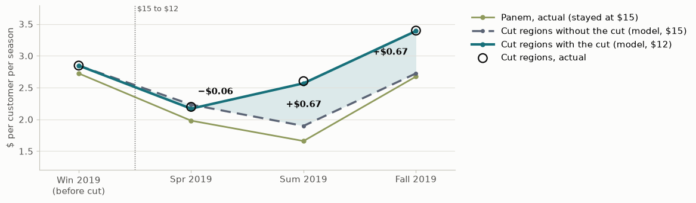
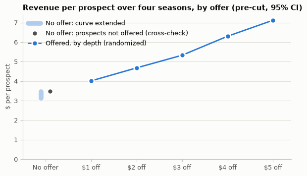
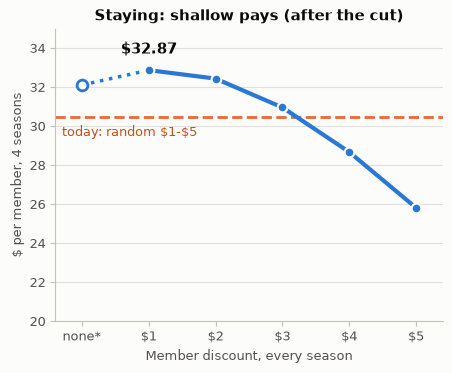

## Overview

1. **Did the 2019 cut from \$15 to \$12 work?** Yes. It raised membership in the five cut regions by about 11 percentage points and paid for itself after one season: \$1.27 more per customer over the three post-cut seasons (+19%), about \$456k across the regions' 358k customers. I would keep the \$12 base.

2. **Do joining discounts pay, and how deep should they be?** Yes, and deeper is better. Before the cut, \$5 off brought in \$7.12 per prospect over four seasons, against \$4.01 at \$1 off and about \$3.10 to \$3.50 with no offer. Revenue was still rising at \$5, so the best depth may lie beyond the tested range.

3. **What should pricing look like going forward?** Keep the \$12 base, give offered prospects \$5 off their first season, and replace today's random \$1 to \$5 member discount with a flat \$1. My forecast tool puts this 13.7% above today's policy in revenue per customer over the next four seasons, and it stays the best option under 2017, 2018 and 2019 advertising.

## How data informed my analysis

- **There is only one control region.** Panem never cut its price, so a difference-in-differences rests on one region, and Panem moved on its own. I ran the DiD, then built a second estimate that does not use Panem.
- **Only the size of a discount is random.** A business rule decides who gets an offer; the \$1 to \$5 depth is then randomized, so comparisons across depths are causal. "No offer" and full price are one-dollar extrapolations.
- **Advertising sets the level of joining.** At \$10, 17.3% of offered prospects joined before the cut and 12.1% after, as fewer heard a podcast ad (42% against 32%). With exposure held equal, joining at a given price was the same in both periods, so both models use each customer's ad exposure instead of season effects.
- **Members get a new random discount every season,** which gives cancellation its own experiment.
- **Raw rates cover only what was tested, so the forecasts use models.**  The joining-discount results are raw means, with regression only adding confidence intervals. But each season tested just five prices (\$10 to \$14 before the cut, \$7 to \$11 after), no winter has been seen at \$12, post-cut advertising was lower, and no member ever paid one flat price for four seasons. The models take the price response from the randomized discounts and the level from ad exposure. They match raw rates within 0.33 points for joining and 0.9 points for cancelling.

## Findings

### *The price cut*

Against Panem, the cut raised membership by 11.5 points (95% CI 8.5 to 14.5). Revenue is less clear. In dollars the DiD gives +\$0.37 per customer per season (CI 0.07 to 0.66), but in percent it gives +1.5% (CI −14% to +20%).

The second estimate replays the cut regions through 2019 at \$12 and at \$15 with the joining and cancellation models. At \$12 it matches actual member share within half a point and revenue within \$0.03 per customer. The cut costs \$0.06 per customer in its first season, while existing members pay \$3 less and new ones build up, then adds \$0.67 in each of the next two. Membership rises 10.4 points, close to the DiD. Panem, which neither model saw, tracks the no-cut path.

  

### *Discounts: deep to join, shallow to stay*

Joining and staying respond to price very differently. For prospects, \$1 off at \$12 multiplies the odds of joining by about 2.3, the offer itself adds nothing beyond the price, and deeper offers bring joins forward, so joiners pay for more seasons. Members are far less price-sensitive, so a deep member discount mostly goes to people who would have stayed anyway. At \$12, \$1 off is worth \$32.87 per member over four seasons, \$5 off only \$25.82, and today's random \$1 to \$5 \$30.46.

  
  

### *Putting it together*

The tool combines the two models, since flat discounts held for several seasons were never tested, and rolls every customer forward from fall 2019 with a quarter of non-members offered, as today. Table 1 compares today's policy with the best of 36 settings at \$12. Dropping the member discount earns almost as much at first but loses members, and its lead shrinks to 6.9% the year after.

| Join / member discount | Revenue per customer | vs today | Next year | Members |
|---|---:|---:|---:|---:|
| Today: random \$1–\$5 | \$13.85 | – | – | 141k |
| **\$5 / \$1** | **\$15.75** | **+13.7%** | **+11.3%** | **136k** |
| \$5 / \$0 | \$15.63 | +12.9% | +6.9% | 125k |
| \$5 / \$2 | \$15.40 | +11.2% | +12.2% | 146k |

**Table 1. The recommended package beats today's policy under every advertising backdrop tested,** ranking first under 2017, 2018 and 2019 ads (\$5 / \$0 is second at worst, \$5 / \$2 fourth). All at a \$12 base, over the next four seasons. "Next year" is revenue against today if the setting is kept four more seasons; "Members" is the count after four seasons.
